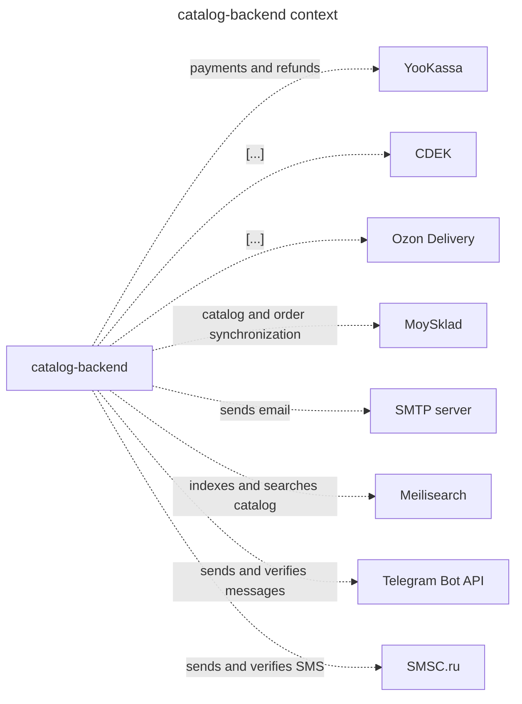
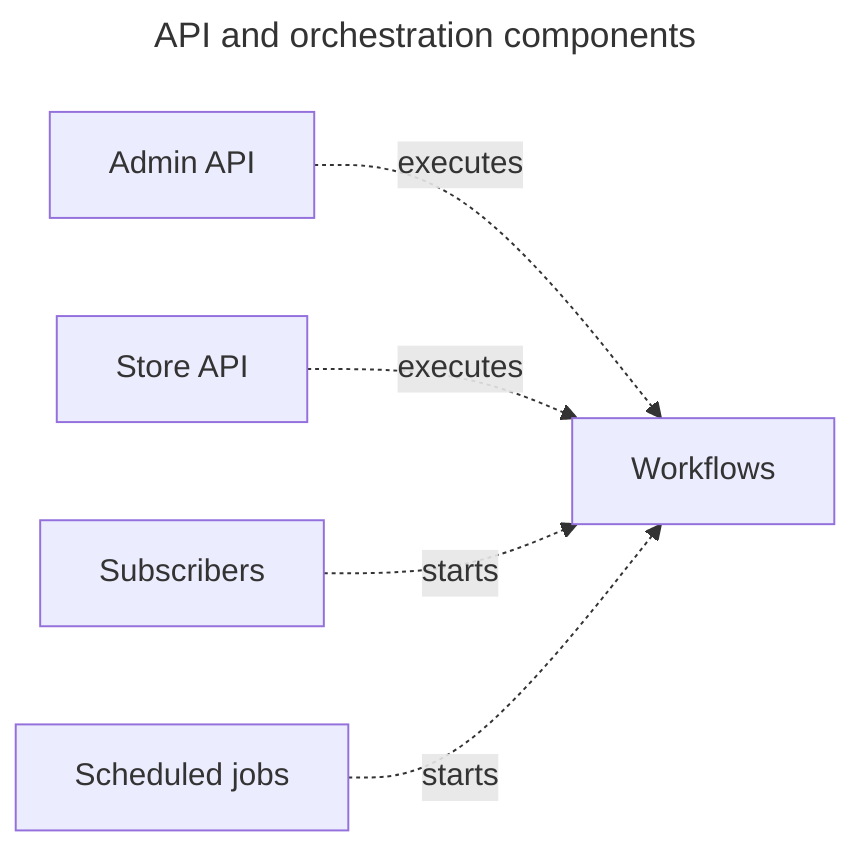
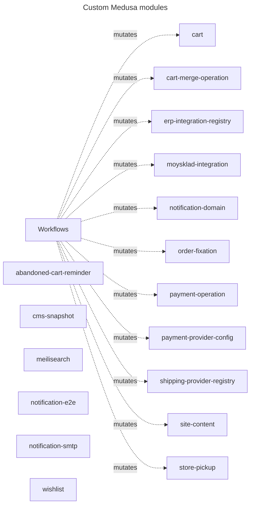
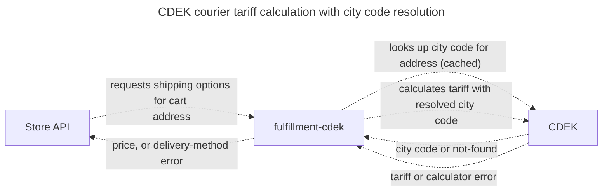
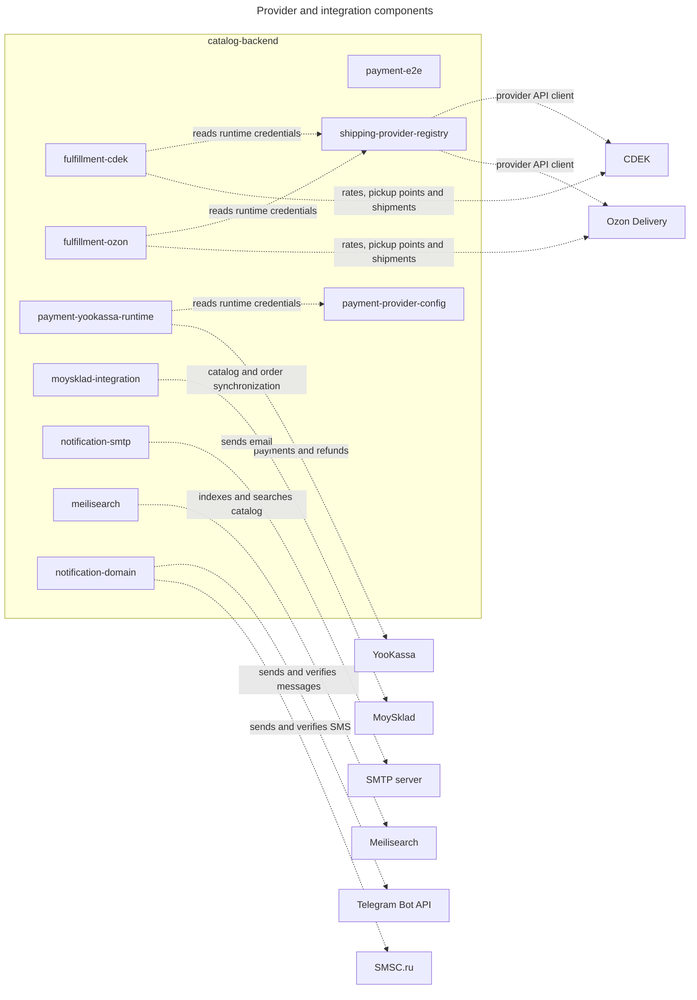

<!-- Generated by likec4 export markdown. Do not edit manually. -->

# catalog-backend — C4 Components

### catalog-backend context

The single Medusa container and the external systems reached by its components.

### API and orchestration components

### Custom Medusa modules

### CDEK courier tariff calculation with city code resolution

### Provider and integration components

